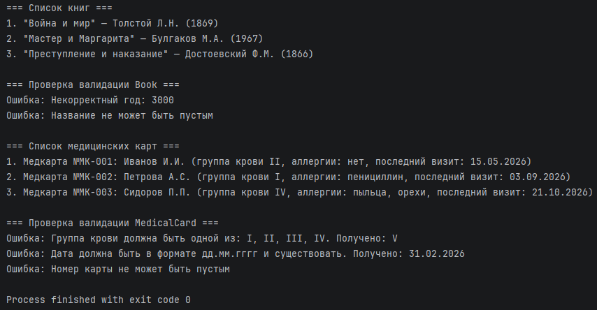

# Отчёт по Лабораторной работе №1

### 1. Титульный лист
**Лабораторная работа №1**  
по дисциплине: «Объектно-ориентированное программирование»  
на тему: «Настройка окружения. Первый класс»

**Вариант №21** (класс «Медицинская карта»)

**Выполнил:**  
Студент группы ИИ21/1 
Поляков А.Р

---

### 2. Цель и задачи работы

**Цель работы:**  
Освоить базовые навыки настройки рабочего окружения Java-разработчика, научиться создавать классы с инкапсуляцией, применять модификаторы доступа, реализовывать методы-аксессоры (getter/setter) и создавать объекты класса.

**Задачи работы:**
1. Установить JDK 17+ и IntelliJ IDEA Community Edition.
2. Настроить Git-репозиторий для проекта.
3. Создать класс `Book` с приватными полями и публичными getter/setter.
4. Реализовать метод `getDescription()`, возвращающий строковое представление книги.
5. Создать несколько объектов класса и вывести их описания.
6. Освоить базовое применение ИИ-инструмента для генерации шаблонного кода.
7. Выполнить индивидуальное задание (вариант 21): создать класс `MedicalCard` с валидацией полей.

---

### 3. Листинги программного кода с пояснениями

*Примечание: во всех классах реализована инкапсуляция. Все поля объявлены `private`, доступ к ним осуществляется через публичные getter и setter, а setter'ы проверяют значения и при нарушении выбрасывают `IllegalArgumentException`.*

#### 3.1. Настройка окружения и Git
Проект `lab01-first-class` создан в IntelliJ IDEA на JDK 27 (Oracle OpenJDK, требование задания: JDK 17+). Исходные файлы лежат в папке `src`. Для работы с версиями установлен Git, репозиторий создан средствами IntelliJ (аналог `git init`), коммиты выполнялись по мере готовности частей работы:

```
Initial commit: lab01 setup
Add Book class and MedicalCard class
```

Служебная папка `.idea` в коммит не включалась.

Ссылка на репозиторий: [вставьте ссылку на ваш репозиторий GitHub]

#### 3.2. Класс `Book` (раздел 3 задания)
Описывает книгу. Поля `id`, `title`, `author`, `year` приватные. В setter'ах `title` и `author` проверяются на `null` и пустоту (проверка на `null` стоит первой, иначе вызов `isBlank()` у `null` приведёт к `NullPointerException`). Год должен быть от 0 до текущего года, текущий год берётся из `Year.now()`. Ключевое слово `this` отличает поле класса от параметра метода. Метод `getDescription()` формирует строку вида `"Война и мир" — Толстой Л.Н. (1869)`, а `toString()` переопределён и возвращает то же самое.

```java
import java.time.Year;
public class Book {
    private long id;
    private String title;
    private String author;
    private int year;
    public Book() {
    }
    public Book(long id, String title, String author, int year) {
        setId(id);
        setTitle(title);
        setAuthor(author);
        setYear(year);
    }
    public long getId() {
        return id;
    }
    public void setId(long id) {
        this.id = id;
    }
    public String getTitle() {
        return title;
    }
    public void setTitle(String title) {
        if (title == null || title.isBlank()) {
            throw new IllegalArgumentException("Название не может быть пустым");
        }
        this.title = title;
    }
    public String getAuthor() {
        return author;
    }
    public void setAuthor(String author) {
        if (author == null || author.isBlank()) {
            throw new IllegalArgumentException("Автор не может быть пустым");
        }
        this.author = author;
    }
    public int getYear() {
        return year;
    }
    public void setYear(int year) {
        if (year < 0 || year > Year.now().getValue()) {
            throw new IllegalArgumentException("Некорректный год: " + year);
        }
        this.year = year;
    }
    public String getDescription() {
        return "\"" + title + "\" — " + author + " (" + year + ")";
    }
    @Override
    public String toString() {
        return getDescription();
    }
}
```

#### 3.3. Класс `MedicalCard` (индивидуальное задание, вариант 21)
Описывает медицинскую карту. Валидация по условию варианта:
- `cardNumber` и `patientName` не могут быть `null` или пустыми;
- `bloodType` может быть только `I`, `II`, `III` или `IV` (допустимые значения хранятся в константе `BLOOD_TYPES`; проверка на `null` идёт первой, так как `List.of(...).contains(null)` выбросило бы `NullPointerException`);
- `lastVisitDate` должна соответствовать формату `дд.мм.гггг`. Для проверки используется `DateTimeFormatter` с шаблоном `dd.MM.uuuu` и режимом `ResolverStyle.STRICT`, поэтому несуществующие даты (например, 31.02.2026) также отклоняются;
- для `allergies` проверок в задании нет, пустое значение заменяется на «нет», чтобы в описании не выводилось `null`.

Метод `getDescription()` возвращает строку вида `Медкарта №МК-001: Иванов И.И. (группа крови II, аллергии: нет, последний визит: 15.05.2026)`.

```java
import java.time.LocalDate;
import java.time.format.DateTimeFormatter;
import java.time.format.DateTimeParseException;
import java.time.format.ResolverStyle;
import java.util.List;
public class MedicalCard {
    private static final List<String> BLOOD_TYPES = List.of("I", "II", "III", "IV");
    private static final DateTimeFormatter DATE_FORMAT =
            DateTimeFormatter.ofPattern("dd.MM.uuuu").withResolverStyle(ResolverStyle.STRICT);
    private String cardNumber;
    private String patientName;
    private String bloodType;
    private String allergies;
    private String lastVisitDate;
    public MedicalCard() {
    }
    public MedicalCard(String cardNumber, String patientName, String bloodType,
                       String allergies, String lastVisitDate) {
        setCardNumber(cardNumber);
        setPatientName(patientName);
        setBloodType(bloodType);
        setAllergies(allergies);
        setLastVisitDate(lastVisitDate);
    }
    public String getCardNumber() {
        return cardNumber;
    }
    public void setCardNumber(String cardNumber) {
        if (cardNumber == null || cardNumber.isBlank()) {
            throw new IllegalArgumentException("Номер карты не может быть пустым");
        }
        this.cardNumber = cardNumber;
    }
    public String getPatientName() {
        return patientName;
    }
    public void setPatientName(String patientName) {
        if (patientName == null || patientName.isBlank()) {
            throw new IllegalArgumentException("Имя пациента не может быть пустым");
        }
        this.patientName = patientName;
    }
    public String getBloodType() {
        return bloodType;
    }
    public void setBloodType(String bloodType) {
        // Проверка на null идёт первой: List.of(...).contains(null) выбросит NullPointerException
        if (bloodType == null || !BLOOD_TYPES.contains(bloodType)) {
            throw new IllegalArgumentException(
                    "Группа крови должна быть одной из: I, II, III, IV. Получено: " + bloodType);
        }
        this.bloodType = bloodType;
    }
    public String getAllergies() {
        return allergies;
    }
    public void setAllergies(String allergies) {
        if (allergies == null || allergies.isBlank()) {
            this.allergies = "нет";
        } else {
            this.allergies = allergies;
        }
    }
    public String getLastVisitDate() {
        return lastVisitDate;
    }
    public void setLastVisitDate(String lastVisitDate) {
        if (lastVisitDate == null) {
            throw new IllegalArgumentException("Дата визита не может быть null");
        }
        try {
            LocalDate.parse(lastVisitDate, DATE_FORMAT);
        } catch (DateTimeParseException e) {
            throw new IllegalArgumentException(
                    "Дата должна быть в формате дд.мм.гггг и существовать. Получено: " + lastVisitDate);
        }
        this.lastVisitDate = lastVisitDate;
    }
    public String getDescription() {
        return "Медкарта №" + cardNumber + ": " + patientName
                + " (группа крови " + bloodType
                + ", аллергии: " + allergies
                + ", последний визит: " + lastVisitDate + ")";
    }
    @Override
    public String toString() {
        return getDescription();
    }
}
```

#### 3.4. Точка входа `Main`
Создаёт по три объекта каждого класса. Часть объектов создаётся конструктором со всеми полями, часть через пустой конструктор и setter'ы. Затем выводятся описания и демонстрируется срабатывание валидации: некорректные значения перехватываются через `try/catch`.

```java
public class Main {
    public static void main(String[] args) {
        //Часть 1. Класс Book
        Book book1 = new Book(1, "Война и мир", "Толстой Л.Н.", 1869);
        Book book2 = new Book(2, "Мастер и Маргарита", "Булгаков М.А.", 1967);
        Book book3 = new Book();
        book3.setId(3);
        book3.setTitle("Преступление и наказание");
        book3.setAuthor("Достоевский Ф.М.");
        book3.setYear(1866);
        System.out.println("=== Список книг ===");
        System.out.println("1. " + book1.getDescription());
        System.out.println("2. " + book2.getDescription());
        System.out.println("3. " + book3); // вызовется toString()
        System.out.println();
        System.out.println("=== Проверка валидации Book ===");
        try {
            book1.setYear(3000);
        } catch (IllegalArgumentException e) {
            System.out.println("Ошибка: " + e.getMessage());
        }
        try {
            book1.setTitle("   ");
        } catch (IllegalArgumentException e) {
            System.out.println("Ошибка: " + e.getMessage());
        }
        //Часть 2. Класс MedicalCard
        MedicalCard card1 = new MedicalCard("МК-001", "Иванов И.И.", "II", "нет", "15.05.2026");
        MedicalCard card2 = new MedicalCard("МК-002", "Петрова А.С.", "I", "пенициллин", "03.09.2026");
        MedicalCard card3 = new MedicalCard();
        card3.setCardNumber("МК-003");
        card3.setPatientName("Сидоров П.П.");
        card3.setBloodType("IV");
        card3.setAllergies("пыльца, орехи");
        card3.setLastVisitDate("21.10.2026");
        System.out.println();
        System.out.println("=== Список медицинских карт ===");
        System.out.println("1. " + card1.getDescription());
        System.out.println("2. " + card2.getDescription());
        System.out.println("3. " + card3);
        System.out.println();
        System.out.println("=== Проверка валидации MedicalCard ===");
        try {
            card1.setBloodType("V");
        } catch (IllegalArgumentException e) {
            System.out.println("Ошибка: " + e.getMessage());
        }
        try {
            card1.setLastVisitDate("31.02.2026");
        } catch (IllegalArgumentException e) {
            System.out.println("Ошибка: " + e.getMessage());
        }
        try {
            card1.setCardNumber("   ");
        } catch (IllegalArgumentException e) {
            System.out.println("Ошибка: " + e.getMessage());
        }
    }
}
```

---

### 4. Протокол работы программы



Текстовый вид вывода:

```
=== Список книг ===
1. "Война и мир" — Толстой Л.Н. (1869)
2. "Мастер и Маргарита" — Булгаков М.А. (1967)
3. "Преступление и наказание" — Достоевский Ф.М. (1866)

=== Проверка валидации Book ===
Ошибка: Некорректный год: 3000
Ошибка: Название не может быть пустым

=== Список медицинских карт ===
1. Медкарта №МК-001: Иванов И.И. (группа крови II, аллергии: нет, последний визит: 15.05.2026)
2. Медкарта №МК-002: Петрова А.С. (группа крови I, аллергии: пенициллин, последний визит: 03.09.2026)
3. Медкарта №МК-003: Сидоров П.П. (группа крови IV, аллергии: пыльца, орехи, последний визит: 21.10.2026)

=== Проверка валидации MedicalCard ===
Ошибка: Группа крови должна быть одной из: I, II, III, IV. Получено: V
Ошибка: Дата должна быть в формате дд.мм.гггг и существовать. Получено: 31.02.2026
Ошибка: Номер карты не может быть пустым
```

---

### 5. Ответы на контрольные вопросы

1. **Что такое класс и объект? В чём их различие?**  
   Класс — это чертёж (шаблон), который описывает структуру (поля) и поведение (методы) объектов. Объект — конкретный экземпляр класса со своим состоянием. Класс описывается один раз, а объектов по нему можно создать сколько угодно: например, `Book` — класс, а `new Book(1, "Война и мир", ...)` — объект.
2. **Какие модификаторы доступа существуют в Java?**  
   `private` — доступ только внутри своего класса; модификатор по умолчанию (package-private) — внутри своего пакета; `protected` — внутри пакета и в подклассах; `public` — отовсюду.
3. **Что такое инкапсуляция? Зачем она нужна?**  
   Инкапсуляция — объединение данных и методов в одном классе и сокрытие внутренней реализации. Она нужна, чтобы защищать состояние объекта от некорректных значений (валидация в setter'ах), менять внутреннюю реализацию без изменения внешнего кода и централизовать проверки в одном месте.
4. **Чем конструктор отличается от обычного метода?**  
   Конструктор имеет то же имя, что и класс, не имеет типа возвращаемого значения (даже `void`), вызывается при создании объекта через `new` и служит для начальной инициализации полей. Обычный метод имеет произвольное имя и тип возврата и вызывается у уже созданного объекта. Если конструкторов в классе нет, компилятор добавляет пустой конструктор по умолчанию.
5. **Для чего используется ключевое слово `this`?**  
   `this` — ссылка на текущий объект. Чаще всего им различают поле класса и параметр с тем же именем (`this.title = title;`), а также вызывают другой конструктор этого же класса (`this(...)`) или передают текущий объект в другие методы.
6. **Что такое классы-обёртки? Что такое автоупаковка?**  
   Для каждого примитивного типа есть класс-обёртка (`int` — `Integer`, `double` — `Double`, `boolean` — `Boolean`, `long` — `Long`). Они нужны, например, для коллекций, которые работают только с объектами, и для значения `null`. Автоупаковка — автоматическое преобразование примитива в объект-обёртку (`Integer n = 42;`), обратное преобразование называется автораспаковкой (`int m = n;`).
7. **Почему прямой доступ к полям класса считается плохой практикой?**  
   Потому что любой внешний код может записать в поле недопустимое значение (отрицательный год, пустое название) в обход проверок, а при изменении внутреннего устройства класса (переименовании поля, смене типа) придётся править весь код, который обращался к полю напрямую. Доступ через методы позволяет контролировать значения и сохранять совместимость.
8. **Какие преимущества даёт ООП по сравнению с процедурным программированием?**  
   ООП позволяет моделировать предметную область через объекты, объединяющие данные и поведение; управлять сложностью через инкапсуляцию; повторно использовать код через наследование и композицию; строить гибкие решения через полиморфизм. В процедурном подходе данные и функции раздельны, поэтому в больших программах труднее поддерживать целостность данных и вносить изменения.

---

### 6. Описание применённых ИИ-инструментов и промптов
Смотреть файл [docs/prompts/prompt.md](docs/prompts/prompt.md)

---

### 7. Выводы

В ходе лабораторной работы было настроено рабочее окружение Java-разработчика: установлены JDK и IntelliJ IDEA, создан проект `lab01-first-class` и подключён Git-репозиторий, коммиты выполнялись по мере готовности частей работы.

Реализованы два класса с инкапсуляцией: `Book` (по заданию на занятии) и `MedicalCard` (индивидуальный вариант 21). Все поля объявлены `private`, доступ к ним организован через getter и setter, а в setter'ах выполняется валидация (пустые значения, допустимые группы крови, формат и существование даты, диапазон года) с выбросом `IllegalArgumentException`. Освоено применение ключевого слова `this`, конструкторов с параметрами и без них, переопределение `toString()` и метод `getDescription()` с заданным форматом вывода. В классе `Main` созданы объекты обоих классов и показано, что некорректные значения отклоняются.

Также получен опыт применения ИИ-инструмента для генерации и доработки шаблонного кода: результат проверялся по чеклисту (валидация, `this`, формат строки, границы значений), а ошибки, возникшие по ходу работы, были разобраны и исправлены. Работа выполнена в полном объёме.
